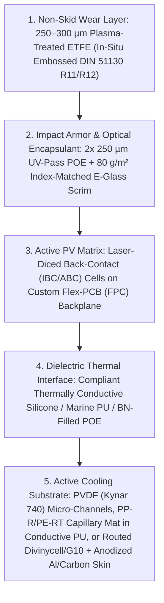

# HelioStrake

**Custom-Shape Walkable Non-Skid Marine Solar Panels with Active Micro-Channel Photovoltaic-Thermal (PV/T) Substrates**

`helio-strake` (**HelioStrake** — combining *Helio* [sun] and *Strake* [a continuous structural band of decking/plating on a vessel]) is an engineering, materials, and CAD/CAM manufacturing project focused on replacing traditional boat deck non-skid surfaces (moulded gelcoat diamond pattern, `Treadmaster`, `KiwiGrip`, or teak/synthetic decking) with **custom-shaped, step-proof photovoltaic-thermal (PV/T) deck modules**.

---

## Why HelioStrake?

Conventional marine solar installations leave `60%–75%` of sun-exposed deck surfaces unused because standard panels are rectangular and cannot conform to curved coachroofs, side decks, and hardware cutouts. Furthermore, gluing standard flexible solar panels directly to an insulated fiberglass sandwich deck (`balsa` or `PVC foam` core) creates a **thermal trap**:
* Un-cooled flush deck panels reach **`65°C–85°C` (`150°F–185°F`)** under summer sun.
* Silicon cells lose **`15%–25%` of their rated electrical output** due to high cell temperatures.
* The deck becomes painfully hot underfoot and radiates **`40–70 W/m²`** of heat through the deckhead into the cabin below.
* Nearly **`700 W/m²` of absorbed solar thermal energy** is wasted.

**HelioStrake** integrates a high-traction embossed fluoropolymer PV laminate directly over a thin **`1–2 mm` micro-channel active cooling substrate**:
1. **Restores `+12% to +18%` electrical output** by holding cell temperatures near `28°C–45°C`.
2. **Harvests `400–550 W_th/m²` of usable thermal energy** (`4.0–5.5 kW` of heat across `10 m²` of deck area) for domestic hot water (calorifier pre-heating), cabin hydronic heating, or thermal desalination—or dumps excess heat to the sea via a keel/hull heat exchanger.
3. **Keeps the deck barefoot-cool (`~30°C–38°C`)** with certified wet anti-slip traction (**DIN 51130 R11/R12**) and stops solar heat transfer into the cabin.

---

## Reference Laminate & Substrate Architecture

### Key Technical Highlights
* **In-Situ Embossed Non-Skid ETFE:** Formed during vacuum lamination using a reusable negative platinum-silicone texture blanket, locking in deep mechanical grip (`>91%` light transmission, self-cleaning, zero glare).
* **Step-Proof Glass Scrim Reinforcement:** Woven E-glass cloth (`80 g/m²`) embedded inside Polyolefin Elastomer (`POE`, zero acetic-acid corrosion) matches the refractive index of cured POE (`n ≈ 1.51` vs `1.49`), remaining optically invisible while boosting point-load impact resistance (dropped winch handles, heels) by `300%+`.
* **High-Density Custom Polygon Packing:** Back-contact (`IBC` / `ABC`, `24%–26.5%` efficiency) cells are laser-diced into current-matched fractional strips and bonded onto a CNC-cut copper/polyimide Flex-PCB (`FPC`) backplane with ideal MOSFET bypass diodes every `6–10 cells` for rigging/foot shadow resilience.
* **Commercial-Grade Active Cooling Substrate (`IEC 61215` & Boatyard-Chemical Ready):**
  * Closely spaced `1.5 × 1.5 mm` polymer micro-channels under a `0.4–0.5 mm` top cap eliminate lateral thermal spreading distance (yielding a `1.5°C–3.0°C` cell-to-coolant $\Delta T$ despite low bulk polymer conductivity).
  * **Mandatory Commercial Material Gate:** While polycarbonate (`PC`) is useful for quick thermal benchmarks, its `128°C–132°C` HDT, `>60°C` hydrolysis, and susceptibility to acetone/diesel/acetoxy-silicone stress cracking rule it out for warranted commercial products. Phase 1 tests the three qualification-grade substrates head-to-head: **`PVDF` (`Kynar 740`)**, **`PP-R`/`PE-RT` capillary mats in filled marine PU**, and **CNC-routed `Divinycell H130`/`G10` + hard-anodized Al/carbon skins**.

---

## Repository Contents

* **[`custom-solar-non-skid-pvt-guide.md`](custom-solar-non-skid-pvt-guide.md)** — Complete engineering, materials science, thermal physics, commercial benchmark comparison, Phase 1 multi-material coupon torture-test plan, and Phase 2 Beneteau 40 Build-vs-Buy tooling & local Annapolis CNC sourcing breakdown.

---

## Development Roadmap

- [x] **Phase 0: Engineering & Architecture Specification**
  - Benchmark commercial walkable marine panels (*Solbian*, *Sunbeam System*, *Gioco*, *CMP*).
  - Define 5-layer non-skid ETFE/POE/E-glass/IBC laminate stack and Phase 3 IEC 61215 / boatyard chemical material gate.
- [ ] **Phase 1: Multi-Material `300 × 300 mm` (`12" × 12"`) Qualification-Grade Coupons**
  - Cast `Shore A 60` platinum-silicone non-skid embossing blanket from master deck texture and laminate `4×` identical Stage-1 ETFE/POE/scrim/IBC skins at `150°C`.
  - Build and bench-test all 3 commercial-grade substrates side-by-side against an un-cooled fiberglass deck control:
    - **Coupon A:** `PVDF` (`Kynar 740`) `1.5 mm` micro-channel base + thermal-welded or single-shot laminated cap.
    - **Coupon B:** `PP-R` / `PE-RT` capillary tube mat vacuum-cast in `ATH`/`SiC`-filled thermally conductive marine polyurethane.
    - **Coupon C:** CNC-routed `Divinycell H130` / `G10` core + `0.8 mm` hard-anodized Al (or carbon-epoxy) skin + `0.5 mm` compliant silicone CTE buffer.
  - Run accelerated abuse suite: `90°C` pump-off stagnation soak (`72 hrs`), `25×` thermal shock cycles (`-20°C` $\leftrightarrow$ `+85°C`), boatyard chemical swipe test (acetone, diesel, teak acid, acetoxy silicone), `1 kg` winch-handle drop + NIR EL crack inspection.
- [ ] **Phase 2: Beneteau Oceanis 40 (*Novella*) Deck + Hardtop Bimini/Dodger Build & CAD/CAM Pipeline**
  - Extend [`process_window_templates.py`](../acrylic-port-refit/process_window_templates.py) into an automated Python cell-packing, Flex-PCB, and fluid-channel routing generator.
  - Execute Hybrid Build/Outsource tooling cell (`$8.5k–$14.5k` CapEx: DIY dual-chamber `1.85 × 0.95 m` laminator + Formica hardtop molds + local Annapolis/Baltimore CNC access) to fabricate `~12–14.5 m²` (`2.5–3.0 kWp` / `5–6.5 kW_th`) of flush deck & hardtop PV/T panels.
- [ ] **Phase 3: Commercial Marine Production & IEC 61215 / 61730 Qualification**
  - Lock in winning commercial substrate from Phase 1/2 real-world sea trials and qualify for multi-year marine warranty production.
