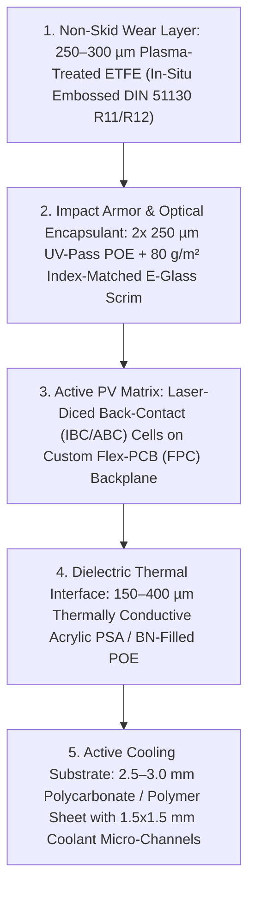

# HelioStrake

**Custom-Shape Walkable Non-Skid Marine Solar Panels with Active Micro-Channel Photovoltaic-Thermal (PV/T) Substrates**

`helio-strake` (**HelioStrake** — combining *Helio* [sun] and *Strake* [a continuous structural band of decking/plating on a vessel]) is an engineering, materials, and CAD/CAM manufacturing project focused on replacing traditional boat deck non-skid surfaces (moulded gelcoat diamond pattern, `Treadmaster`, `KiwiGrip`, or teak/synthetic decking) with **custom-shaped, step-proof photovoltaic-thermal (PV/T) deck modules**.

---

## Why HelioStrake?

Conventional marine solar installations leave `60%–75%` of sun-exposed deck surfaces unused because standard panels are rectangular and cannot conform to curved coachroofs, side decks, and hardware cutouts. Furthermore, gluing standard flexible solar panels directly to an insulated fiberglass sandwich deck (`balsa` or `PVC foam` core) creates a **thermal trap**:
* Un-cooled flush deck panels reach **`65°C–85°C` (`150°F–185°F`)** under summer sun.
* Silicon cells lose **`15%–25%` of their rated electrical output** due to high cell temperatures.
* The deck becomes painfully hot underfoot and radiates **`40–70 W/m²`** of heat through the deckhead into the cabin below.
* Nearly **`700 W/m²` of absorbed solar thermal energy** is wasted.

**HelioStrake** integrates a high-traction embossed fluoropolymer PV laminate directly over a thin **`1–2 mm` micro-channel active cooling substrate**:
1. **Restores `+12% to +18%` electrical output** by holding cell temperatures near `28°C–45°C`.
2. **Harvests `400–550 W_th/m²` of usable thermal energy** (`4.0–5.5 kW` of heat across `10 m²` of deck area) for domestic hot water (calorifier pre-heating), cabin hydronic heating, or thermal desalination—or dumps excess heat to the sea via a keel/hull heat exchanger.
3. **Keeps the deck barefoot-cool (`~30°C–38°C`)** with certified wet anti-slip traction (**DIN 51130 R11/R12**) and stops solar heat transfer into the cabin.

---

## Reference Laminate & Substrate Architecture

### Key Technical Highlights
* **In-Situ Embossed Non-Skid ETFE:** Formed during vacuum lamination using a reusable negative platinum-silicone texture blanket, locking in deep mechanical grip (`>91%` light transmission, self-cleaning, zero glare).
* **Step-Proof Glass Scrim Reinforcement:** Woven E-glass cloth (`80 g/m²`) embedded inside Polyolefin Elastomer (`POE`, zero acetic-acid corrosion) matches the refractive index of cured POE (`n ≈ 1.51` vs `1.49`), remaining optically invisible while boosting point-load impact resistance (dropped winch handles, heels) by `300%+`.
* **High-Density Custom Polygon Packing:** Back-contact (`IBC` / `ABC`, `24%–26.5%` efficiency) cells are laser-diced into current-matched fractional strips and bonded onto a CNC-cut copper/polyimide Flex-PCB (`FPC`) backplane with ideal MOSFET bypass diodes every `6–10 cells` for rigging/foot shadow resilience.
* **`1–2 mm` Polymer Micro-Channel Cooling Substrate:**
  * Closely spaced `1.5 × 1.5 mm` fluid channels under a thin `0.38–0.50 mm` (`15–20 mil`) top polycarbonate/polymer cap eliminate lateral thermal spreading distance.
  * Despite neat polycarbonate's low bulk conductivity (`k = 0.20 W/m·K`), 1D vertical conduction across the `0.4 mm` top wall creates only a **`1.0°C` temperature drop** at `500 W/m²` heat flux, yielding a total cell-to-coolant $\Delta T$ of just **`1.5°C–3.0°C`** with zero metal corrosion and high compressive crush strength (`>250 kPa`).

---

## Repository Contents

* **[`custom-solar-non-skid-pvt-guide.md`](custom-solar-non-skid-pvt-guide.md)** — Complete engineering, materials science, thermal physics, commercial benchmark comparison, equipment CapEx/BOM analysis, and Phase 1 prototyping guide.

---

## Development Roadmap

- [x] **Phase 0: Engineering & Architecture Specification**
  - Benchmark commercial walkable marine panels (*Solbian*, *Sunbeam System*, *Gioco*, *CMP*).
  - Define 5-layer non-skid ETFE/POE/E-glass/IBC laminate stack and two-stage polycarbonate `1–2 mm` micro-channel substrate bonding process.
- [ ] **Phase 1: `300 × 300 mm` (`12" × 12"`) Proof-of-Concept Coupons**
  - Cast `Shore A 60` platinum-silicone non-skid embossing blanket from master deck texture.
  - Laminate Stage-1 ETFE/POE/scrim/IBC solar skin at `150°C`.
  - CNC-mill `1.5 × 1.5 mm` serpentine/bifurcated micro-channels into `2.5 mm` polycarbonate base sheet, cap with `0.38 mm` `Lexan 8010` film (`Loctite AA 3311` UV adhesive / laser weld), and vacuum-bond to Stage-1 PV skin at room temperature.
  - Perform side-by-side solar thermal/electrical bench testing (un-cooled FRP deck cutout vs active propylene-glycol loop).
- [ ] **Phase 2: Automated Template-to-CAD/CAM Pipeline**
  - Extend optical deck template capture into an automated Python solver that takes a deck non-skid polygon DXF and outputs:
    1. Fractional IBC cell packing layout & laser-scribing G-code.
    2. Custom Flex-PCB copper interconnect DXF.
    3. Matched serpentine/bifurcated micro-channel CNC routing G-code.
- [ ] **Phase 3: Full-Scale Marine Deck Integration**
  - Fabricate custom coachroof and side-deck PV/T modules with combined single-hole rear Delrin fluid + electrical bosses and dual-mode calorifier / keel-cooler valve control.
