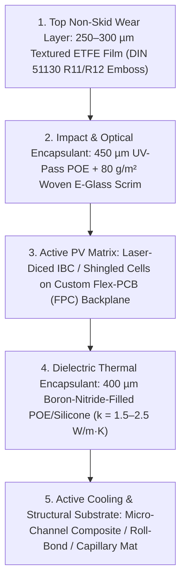
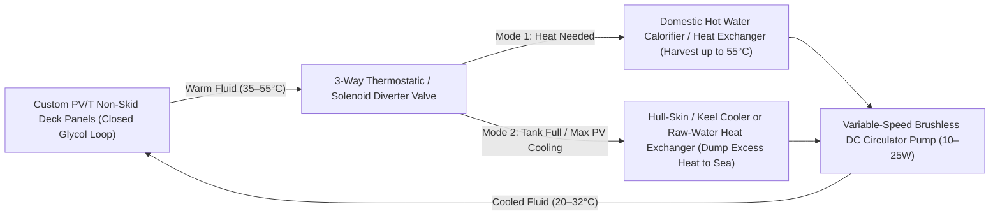
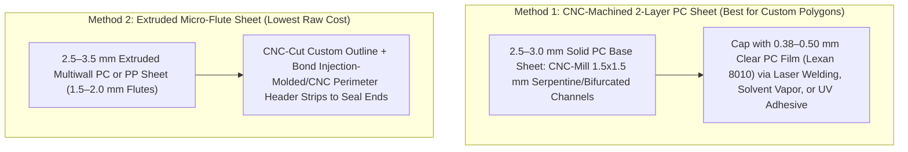

# Custom-Shape Non-Skid Marine Solar Panels with Active Thermal (PV/T) Substrates: Market & Production Engineering Guide

Replacing moulded fiberglass non-skid, teak, or synthetic EVA/PVC decking (`Treadmaster`, `SeaDek`, `Flexiteek`) with **custom-shaped, walkable photovoltaic-thermal (PV/T) deck panels** solves three fundamental problems on modern cruising and hybrid-electric yachts:
1. **Deck Real Estate:** Standard rectangular solar panels only fit on bimini/arch structures or flat coachroof centerlines, leaving `60%–75%` of the sun-exposed deck (side decks, foredeck, cockpit coamings, curved coachroof islands) unutilized.
2. **The Thermal Trap of Flush Deck Solar:** Conventional flush-mounted marine solar panels bonded directly to a cored fiberglass deck (`balsa` or `PVC foam` sandwich) have zero backside airflow. Under summer sun, dark solar cells reach **`65°C–85°C` (`150°F–185°F`)**, causing a **`15%–25%` drop in electrical output**, accelerating polymer delamination, making the deck painful to walk on bare-footed, and turning the cabin ceiling below into a giant radiant heater.
3. **Wasted Thermal Energy:** Approximately **`70%` of incident solar irradiance** absorbed by a solar cell is converted into waste heat. On a `40-foot` sailboat with `8–12 m²` of usable non-skid deck area, that represents **`5.5–8.5 kW` of thermal power** that can either be harvested (for domestic hot water, cabin heating, or desalination) or rejected to the sea to keep the deck cool and electrical efficiency high.

---

## 1. Current Market Options: Custom Walkable Non-Skid Marine Solar

Before designing an in-house production process, it is useful to benchmark existing commercial marine walkable solar manufacturers and where their current architectures fall short.

### A. Commercial Manufacturers & Product Lines

| Manufacturer / Line | Cell Technology | Non-Skid Surface & Stack | Custom Shape Capability | Thermal / Substrate Architecture | Approx. Retail Price |
| :--- | :--- | :--- | :--- | :--- | :--- |
| **Solbian** (*SP*, *SR*, & *All-in-One* Series) | **SP:** SunPower Maxeon IBC (`~24%` eff.) **SR:** Monocrystalline with patented full-surface metallic micro-grid | Textured fluoropolymer (ETFE/PVDF) frontsheet with micro-lens / pebble anti-slip texture; optional rear-exit junction box & `3M` acrylic foam adhesive | **High (Bespoke):** Custom outer CAD outlines, custom cell count/layout, and colored backsheets (`white`, `black`, `grey`, `teak-look`) to blend with deck | **None (Passive):** Standard `~2 mm` polymer laminate; relies on low cell temp coefficient (`-0.29%/°C`) | `$22 – $35 / Watt` (`~$4,000–$6,500/m²` for custom shapes) |
| **Sunbeam System** (*Tough+*, *Flush*, *Carbon*) | SunPower Maxeon IBC (`23.7%–24.5%` eff.) with shadow-optimized short sub-strings | **Tough+ Surface:** Aggressive profiled non-skid embossing (`DIN`-grade wet grip, anti-glare, no water pooling); `3 mm` thick | **Low–Medium:** Wide range of standard marine shapes/sizes; custom OEM shapes only for production boatbuilders | **None (Passive):** Polymer laminate (`3 mm` thick); bonds directly to deck with `Sikaflex` or `3M VHB` | `$12 – $18 / Watt` (standard shapes) |
| **Gioco Solutions** (*GFT Walkable Series*) | Monocrystalline PERC / IBC (`19%–23%` eff.) | Patented **GFT** (techno-polymer matrix) with heavy-duty certified marine anti-slip top coat | **Medium–High:** Custom dimensions and irregular polygons available via factory engineering | **None (Passive):** Polymer composite backsheet | `$10 – $16 / Watt` |
| **Custom Marine Products (CMP)** | SunPower Maxeon Gen 3 / Gen 6 IBC | Thick embossed non-skid ETFE top sheet (`~3–4 mm` total module thickness) | **High:** Custom rectangle and tapered marine templates built to order | **Passive Stiffener:** Uses rigid **anodized aluminum** or **fiberglass (FRP)** backing plate to prevent cell micro-cracking under foot traffic | `$14 – $20 / Watt` |
| **Onyx Solar / SolarPave** (*Walkable BIPV Glass*) | Crystalline silicon or thin-film laminated inside tempered glass | Acid-etched / ceramic-fritted anti-slip tempered glass (**DIN 51130 R11–R13** certified) | **High:** Architectural custom polygons and curves | **None (Heavy Glass):** `15–25 mm` triple-laminated glass (`30–50 kg/m²`)—far too heavy for yacht decks; only viable for marinas/pontoons | `$800 – $1,800 / m²` |

### B. Limitations of Existing Commercial Options
1. **No Active Cooling or Heat Harvesting:** Every commercial marine panel on the market today is a passive polymer or metal-backed laminate. When glued to an insulated fiberglass sandwich deck, cell temperatures soar `35°C–50°C` above ambient air temperature.
2. **Rectangular Cell Packing in Curved Non-Skid Islands:** Even when Solbian or Gioco cuts a custom curved or trapezoidal polymer perimeter to match a boat's moulded non-skid island, they still populate the interior with **whole `125×125 mm` or `166×83 mm` rectangular cells**. On narrow side decks or curved coachroof panels, **`30%–45%` of the panel area remains empty dead border** (inactive backsheet).
3. **Edge Profile & Tripping Hazards:** Unless the boat's deck is specifically molded with a `3–4 mm` recessed rabbet (like factory Outremer or Solaris builds), surface-mounting a `3 mm` panel creates a raised edge that traps dirt and catches shoes unless finished with a tapered elastomeric bevel seal.

---

## 2. Engineering the Custom Non-Skid PV Stack (Top-to-Bottom Architecture)

To truly replace deck non-skid (matching the traction of `Awlgrip Griptex`, `KiwiGrip`, or `Treadmaster`) while surviving dropped winch handles, stiletto heels, saltwater immersion, and UV exposure, the photovoltaic top laminate requires a specific 5-layer materials stack.

### Layer 1: The Non-Skid Top Surface (`ETFE` + In-Situ Embossing)
* **Material:** **`200–300 µm` ETFE (Ethylene Tetrafluoroethylene)** film (e.g., *AGC Fluon ETFE*, *Saint-Gobain Norton ETFE*, or *Nowofol ETFE*), corona- or plasma-treated on the bottom side for encapsulant adhesion.
  * *Why ETFE over PET/Urethane/Epoxy?* Clear epoxy and polyurethane yellow and micro-craze within 18–24 months of marine UV exposure. PET delaminates and turns cloudy. ETFE has `>92%` light transmission across the solar spectrum, a `20+ year` UV lifespan, chemical immunity to diesel/solvents/salt, and low surface energy (self-cleaning).
* **How the Non-Skid Texture is Created in Production:**
  * Rather than buying lightly matte film, high-traction marine non-skid (`DIN 51130 R11–R12` or `ASTM F1677` wet coefficient of friction `>0.65`) is formed **during vacuum lamination**:
  * A **textured silicone or PTFE release blanket (embossing mat)** with a negative pyramid, micro-diamond, or coarse pebble pattern (`150–400 µm` peak-to-valley depth) is placed directly on top of the ETFE film inside the vacuum laminator.
  * At `145°C–155°C` and `0.8–1.0 bar` vacuum pressure, the softened ETFE and underlying encapsulant conform into the embossing mat, permanently locking in a mechanical non-skid tread that also acts as a **light-trapping retro-reflector** (improving low-angle morning/evening solar yield by `4%–7%` and eliminating glare into the helmsman's eyes).

### Layer 2: Impact-Resistant Encapsulant (`POE` + Index-Matched Glass Scrim)
* **Never Use Standard EVA in Marine Applications:** Standard Ethylene Vinyl Acetate (EVA) absorbs trace moisture and undergoes hydrolysis under heat, releasing **acetic acid** (vinegar smell) that corrodes copper interconnects and causes delamination.
* **Use POE (Polyolefin Elastomer) or TPO (Thermoplastic Polyolefin):** Zero acetic acid generation, `10×` lower moisture vapor transmission rate (MVTR), and superior adhesion to ETFE.
* **Walkable Point-Load Armor (The Secret to "Step-Proof" Panels):**
  * Sandwich a thin **`50–100 g/m²` woven E-glass fiberglass scrim** inside two sheets of `250 µm` POE directly above the solar cells.
  * Because the refractive index of E-glass (`n ≈ 1.51–1.54`) closely matches cured POE (`n ≈ 1.49`), the fiberglass cloth becomes **optically invisible (`<1.5%` transmission loss)** once laminated under vacuum, while increasing puncture resistance and flexural stiffness above the silicon wafer by `300%+`.

### Layer 3: Solar Cell Selection, Custom Polygon Cutting, & Shadow Topology
To fill irregular deck non-skid shapes (around mast collars, hatches, dorade boxes, and curved gunwales) with high active-area density:
1. **Cell Chemistry — Back-Contact (IBC / ABC / HPBC):**
   * Use **Interdigitated Back Contact (IBC)** cells (e.g., *Maxeon Gen 3/6* with solid copper backing, *Longi HPBC*, or *Aiko N-Type ABC* at **`24.0%–26.5%` efficiency**).
   * *Why Back-Contact?*
     * **Zero front busbars:** Uniform matte dark-blue/black aesthetic that looks like high-end marine non-skid rather than an industrial solar panel.
     * **Mechanical toughness:** Maxeon cells have a thick electroplated copper foundation on the rear; even if the silicon cracks under heavy foot impact, the copper grid holds the circuit intact.
     * **Easy custom interconnections:** Both positive and negative pads are on the back surface.
2. **Filling Irregular Shapes via Laser Scribing (Fractional & Shingled Cells):**
   * Standard `M10` (`182×182 mm`) or `G12` (`210×210 mm`) wafers can be cut on a **non-destructive fiber/UV laser dicer** into `1/2`, `1/3`, `1/4`, or `1/6` rectangular strips, as well as **45° / 60° mitered end-cells** for tapered foredeck panels.
   * By combining uniform strip widths (so current $I_{mp}$ stays matched within a series string) or wiring differently sized zones in parallel sub-strings with independent MPPT channels, active cell coverage inside irregular non-skid islands increases from `~55%` to **`80%–88%`**.
3. **Flexible Printed Circuit (FPC) Backplane Instead of Linear Tabber Ribbons:**
   * Traditional solar factories use linear tabber-stringer machines that only solder straight rows.
   * For custom deck shapes, the superior production method is a **CAD-routed copper/polyimide or copper/PET Flexible PCB (FPC) backsheet** (or CNC-cut tin-coated copper foil bus-matrix).
   * You lay the laser-cut back-contact cells onto a CNC alignment jig, place the custom-routed copper foil/FPC over the rear solder pads (pre-dispensed with low-temp `SnBiAg` solder paste or electrically conductive adhesive `ECA`), and reflow/bond the entire custom polygon during or just prior to lamination.
4. **Partial Shading Mitigation (Stanchions, Rigging, Feet):**
   * Divide every deck panel into compact sub-strings (`6 to 10 cells` in series, `~3.8 V – 6.5 V` per sub-string) bridged by **low-drop Schottky bypass diodes** or **ideal MOSFET bypass diodes** (`<0.05 V` drop, zero heat dissipation), feeding either a boost MPPT controller (e.g., *Genasun* / *Victron*) or an integrated rear-mounted micro-optimizer.

### Layer 4: Thermally Conductive Dielectric Interface
* Standard polymer backsheets (`PET/PVF Tedlar`) are designed to be electrical insulators, which unfortunately makes them **thermal insulators** (`k ≈ 0.15–0.20 W/m·K`).
* To transfer heat efficiently from the rear of the solar cells into the cooling substrate below while maintaining `>1,500 V DC` electrical isolation:
  * Replace the standard rear EVA/PET backsheet with a **`300–450 µm` Boron Nitride (`BN`) or Alumina (`Al2O3`) filled POE/Silicone thermal encapsulant film** (`k = 1.5–2.5 W/m·K`), or a thin **`75 µm` Kapton HN polyimide dielectric film** bonded with thermally conductive structural silicone/epoxy adhesive.

---

## 3. Developing the Heat-Collecting & Cooling Substrate (Marine PV/T)

### A. Thermal Physics & Energy Balance on Deck
Under peak marine sun (`1,000 W/m²` irradiance, `30°C` ambient air):
* **Electrical conversion:** `~220 W/m²`
* **Optical reflection:** `~70 W/m²`
* **Thermal generation in panel:** **`~710 W/m²`**

| Operating Mode | Cell Temp ($T_{cell}$) | Power Loss vs STC (`25°C`) | Net Electrical Output | Thermal Harvest ($Q_{th}$) | Barefoot Deck Comfort | Cabin Heat Gain Below |
| :--- | :--- | :--- | :--- | :--- | :--- | :--- |
| **Un-cooled Flush Deck Panel** (Glued to cored FRP deck) | `75°C – 82°C` | `-14% to -21%` | `~180–190 W/m²` | `0 W/m²` (Wasted) | **Painful / Burn Hazard** (`>60°C` threshold) | **High** (Radiates `40–70 W/m²` into cabin) |
| **Active PV/T Heat-Harvesting Mode** (Heating domestic water to `45°C`) | `42°C – 48°C` | `-5% to -7%` | `~208–215 W/m²` (**`+12%` gain**) | **`400 – 500 W_th/m²`** (`4–5 kW` per `10 m²`) | **Warm & Comfortable** (`~38°C` surface) | **Near Zero** (Substrate intercepts heat) |
| **Active PV/T Seawater Cooling Mode** (Dumping heat to `22°C` sea loop) | `26°C – 32°C` | `-0.3% to -2%` | `~220–225 W/m²` (**`+18%` gain**) | Dumped to sea (`~550 W_th/m²` removed) | **Cool to Touch** (`~28°C` surface) | **Negative** (Cools cabin ceiling!) |

---

### B. Comparing the 4 Viable Cooling Substrate Architectures

Here are the four engineering approaches to building the heat-collecting substrate beneath the custom PV laminate, ranked by suitability for custom-shape marine production:

#### Option 1: CNC-Routed Composite / High-Density Foam Micro-Channel Core + Metal/Carbon Heat Spreader (Best for Custom Shapes & In-House CNC Production)
* **How It Is Built:**
  1. Start with a **`6 mm to 8 mm` sheet of high-density closed-cell structural foam** (`Divinycell H130/H200`, `Corecell M130`, or `Coosa Bluewater 26`) or `G10/FR4` composite sheet, CNC-cut to the exact custom non-skid perimeter.
  2. Use a `3-axis CNC router` to mill a continuous **serpentine or bifurcated parallel micro-channel labyrinth** (`4 mm` wide × `3 mm` deep channels on `8–10 mm` centers) across the top face of the core, routing entry/exit manifolds to a single recessed boss on the underside.
  3. Seal the routed foam channels with a thin brush/spray coat of low-viscosity epoxy so the foam cells are 100% fluid-tight.
  4. Bond a **`0.8–1.0 mm` 5083/6061 marine-grade anodized aluminum sheet** (or **copper-mesh / pitch-based high-conductivity carbon fiber prepreg skin**) directly over the open channels using toughened epoxy film adhesive (`3M Scotch-Weld AF 163` or `Gurit Spabond`), forming sealed fluid passages directly beneath the heat-spreading top skin.
  5. Laminate the custom PV cell stack directly onto the anodized aluminum/carbon top skin using thermally conductive POE (`Layer 4`).
* **Pros:**
  * **100% Custom Geometry with Zero Tooling Cost:** Any shape you can draw in DXF can be CNC-routed in 15 minutes on a standard `4×8 ft` router.
  * **Built-In Bottom Insulation:** The `3–5 mm` of uncut closed-cell foam remaining at the bottom of the substrate acts as a **thermal barrier between the fluid channels and the boat's deck**, ensuring heat goes into the fluid rather than into the cabin below.
  * **High Compressive Strength:** Easily supports heavy foot traffic and dropped gear without crushing channels.
* **Weight & Thickness:** `~8–10 mm` total thickness (can sit flush if old non-skid/balsa skin is recessed, or beveled at `30°` around the perimeter); `~4.5–5.5 kg/m²` wet.

#### Option 2: Polymer Capillary Tube Mat (`PP-R` / `PE-RT`) Cast in Thermally Conductive Elastomer/Epoxy (Best for Compound Curves & Zero Corrosion)
* **How It Is Built:**
  1. Use pre-manufactured **polymer capillary mats** (extruded `PP-R`, `PE-RT`, or `PVDF` micro-tubes with `2.5–3.5 mm` outer diameter, `0.3 mm` wall thickness, spaced `8–12 mm` apart, welded to flexible supply/return headers).
  2. Lay the capillary mat on the back of the PV laminate inside a perimeter dam and vacuum-infuse or cast it in a **`3.5–4.5 mm` layer of thermally conductive polyurethane or flexible epoxy** loaded with `60%–70%` by weight **Aluminum Trihydrate (`ATH`) or Silicon Carbide (`SiC`) powder** (`k ≈ 1.2–1.8 W/m·K`).
* **Pros:**
  * **100% Immune to Saltwater & Galvanic Corrosion:** Can even circulate raw filtered seawater directly if desired, though closed-loop is still cleaner.
  * **Conforms to Cambered & Curved Decks:** Because both the capillary tubes and the filled polyurethane/silicone matrix are semi-flexible, the finished `5–6 mm` panel bends smoothly over cambered coachroofs and foredecks.
  * **Freeze-Tolerant:** Thin-wall polymer capillaries expand elastically if fluid freezes.
* **Cons:** Slightly higher thermal resistance (`ΔT ≈ 4°C–6°C` between cell and fluid compared to `1.5°C–2.5°C` for aluminum).

#### Option 3: Custom Aluminum Roll-Bond or Multi-Port Microchannel Plate (Highest Thermal Transfer, Higher Tooling Cost for Custom Shapes)
* **How It Is Built:**
  * Two sheets of `0.8 mm` aluminum (`1060` or `3003` alloy) are screen-printed with a graphite stop-weld pattern matching the custom panel's fluid circuit, hot-rolled together into a solid `1.5 mm` metallurgical sheet, and inflated under `100+ bar` hydraulic pressure inside a flat die so only the printed channels pillow open (`2 mm` channel height).
* **Pros:** Unbeatable lateral thermal conductivity (`~200 W/m·K`), ultra-thin (`2.5–3.5 mm` total substrate thickness), very high heat removal factor ($F_r$).
* **Cons:**
  * Every unique custom panel shape requires a custom screen-print/inflation pattern (economical for 20+ identical boat kits, expensive for one-off custom shapes unless using modular rectangular sub-plates underneath a full-size custom top laminate).
  * **CTE Mismatch:** Aluminum expands at `23 × 10⁻⁶ /K` while silicon expands at `2.6 × 10⁻⁶ /K`. You **must** bond the PV laminate to the aluminum roll-bond plate using a compliant, high-elongation **thermally conductive silicone elastomer (`0.5–0.8 mm` thick)** rather than rigid EVA/epoxy, or thermal cycling will shear the cells.

#### Option 4: Passive Phase-Change Material (PCM) Backing (No Plumbing / Pumps Required)
* **How It Is Built:** A `4–6 mm` backing layer of **form-stable micro-encapsulated paraffin / bio-wax PCM** (`melt point 29°C–34°C`, latent heat `180–220 kJ/kg`) compounded into a conductive graphite/elastomer matrix.
* **Pros:** Zero through-deck plumbing, pumps, or manifolds; absorbs midday solar heat spike for `3–4 hours` and releases it into the night breeze.
* **Cons:** Once the PCM fully melts by early afternoon in the tropics, cooling stops and temperatures climb; does not harvest usable hot water for the boat.

---

### C. Plumbing & System Integration on the Boat

1. **Single Through-Deck Penetrations (Combined Power + Fluid Boss):**
   * Each custom panel uses a **machined `Delrin` (acetal) or `G10` rear manifold puck (`35–45 mm` diameter)** bonded to the underside of the panel in a corner located over an accessible interior headliner/locker space.
   * The puck passes through a single hole in the deck (bedded in `Sikaflex 291i` or butyl tape) and carries:
     * Two `6 mm` or `8 mm` push-to-connect (`John Guest` / barbed PEX) coolant ports (`Supply` & `Return`).
     * One potted waterproof `2-wire` or `4-wire` electrical pigtail.
2. **Closed-Loop Inhibited Propylene Glycol (Non-Toxic):**
   * Run a low-pressure (`0.5–1.2 bar`), closed loop filled with `30%` USP food-grade **propylene glycol + deionized water + corrosion inhibitor**.
   * **Parasitic Pump Power vs. Electrical Gain:** A tiny `12V / 24V` brushless magnetic-drive circulation pump (`e.g., Laing D5 / March / Brushless DC`) consumes only **`8 W to 18 W`**, while cooling `8 m²` (`~1,800 Wp`) of deck solar recovers **`180 W to 300 W` of lost electrical power**—a **`12:1 to 20:1` net electrical return**, plus **`3.5–4.5 kW` of free hot water**!

---

## 4. What It Takes to Develop Production of Custom Non-Skid PV/T Panels

If you want to develop an in-house R&D / boutique manufacturing capability to produce custom-shaped non-skid PV/T panels (either for your own fleet refits or as a commercial marine product), the workflow breaks down into **CAD/CAM Automation**, **Core Equipment**, and **Process Qualification**.

### A. Automated CAD/CAM Pipeline (Template $\rightarrow$ Cell Packing $\rightarrow$ CNC & Laser Files)
You already have an optical template-to-DXF pipeline in this repository ([`process_window_templates.py`](../process_window_templates.py)). Extending that exact software architecture to custom solar decks gives you a massive competitive moat:
1. **Step 1 — Deck Capture:** Photograph or 2D-digitize the existing deck non-skid islands (with reference scale markers) to generate clean closed polygon DXFs with obstacle cutouts (winches, cleats, hatches).
2. **Step 2 — Automated Cell Packing & String Solver (Python):**
   * Input: Polygon DXF + inset border margin (`12–15 mm` for waterproof edge seal).
   * Algorithm: Packs standard fractional IBC cell sizes (e.g., `1/2`, `1/3`, `1/6` cuts of `182 mm` cells, or shingled strips) to maximize active area while ensuring every series string has identical cell area (current matching).
   * Output 1: **Laser Dicer G-code** for cutting any fractional/mitered edge cells.
   * Output 2: **Flex-PCB / Copper Bus Foil DXF** for CNC cutting the back-contact interconnect layer and bypass diode locations.
   * Output 3: **Substrate Fluid Channel G-code** for CNC routing the serpentine cooling labyrinth directly underneath the active cell footprint.

---

### B. Production Process Flow (7-Step Manufacturing Cell)

1. **Substrate Machining & Sealing:**
   * CNC-route the custom panel perimeter and fluid micro-channels into high-density closed-cell foam (`Divinycell H130`) or G10 composite; bond the rear fluid/wire boss; epoxy-seal the channels; vacuum-bag the `0.8 mm` anodized aluminum or carbon heat-spreader skin on top. *(Alternatively, cast a polymer capillary mat into a CNC-molded conductive elastomer tray).*
2. **Laser Cell Scribing & Cleaving:**
   * Use a `30W–50W` fiber/UV laser to scribe back-contact solar wafers to the required fractional strip sizes.
3. **Interconnect Layup (Pick-and-Place on Alignment Jig):**
   * Place the CNC-cut copper interconnect backplane / Flex-PCB onto a registration pin jig; stencil low-temperature ductile solder paste (`Sn42Bi57Ag1` or conductive silicone adhesive) onto the pads; place the IBC cells face-down; run through a compact infrared reflow zone (or reflow during lamination).
4. **Stack Assembly (Book Layup):**
   * Stack from bottom to top on the laminator tray:
     * *Option A (Single-Shot Lamination):* Cooling Substrate $\rightarrow$ Thermally Conductive POE (`400 µm`) $\rightarrow$ Wired Cell Matrix $\rightarrow$ Clear POE (`250 µm`) $\rightarrow$ `80 g/m²` E-Glass Scrim $\rightarrow$ Clear POE (`250 µm`) $\rightarrow$ Plasma-Treated ETFE (`250 µm`) $\rightarrow$ **Textured Silicone Non-Skid Embossing Blanket**.
     * *Option B (Two-Stage — Recommended for High Yield):* Laminate the top PV module first (`Tedlar/Thin Kapton` rear film + cells + glass scrim + POE + textured ETFE), test it electrically (`EL + Flash test`), and then vacuum-bond the tested PV laminate onto the cooling substrate using a room-temperature/low-temp **thermally conductive silicone/polyurethane adhesive**. **Why Two-Stage?** If a cell cracks or a solder joint fails during lamination, you don't scrap the machined cooling substrate, and you avoid high-temperature CTE bowing (`150°C` cure) between the metal/composite cooling plate and the silicon cells!
5. **Vacuum Lamination:**
   * Pull vacuum (`<100 Pa`) for `5–6 minutes` to evacuate all air from the glass scrim and cell gaps, then apply top bladder pressure (`0.6–0.9 bar`) at `145°C–150°C` for `12–16 minutes` to cross-link the POE and emboss the ETFE non-skid texture.
6. **Edge CNC Trimming & Perimeter Sealing:**
   * CNC-trim the cured laminate flush with the custom substrate perimeter (leaving the `12–15 mm` cell-free border) and seal the perimeter edge with UV-stable marine polyurethane/silicone edge sealant.
7. **Quality Control (QC) Testing:**
   * **Electroluminescence (EL) Camera Inspection:** Apply forward DC bias current in a dark box and image with a `950–1050 nm` NIR camera (a modified mirrorless camera with IR filter removed + `950 nm` longpass filter) to verify zero micro-cracks or cold solder joints.
   * **Hydrostatic Pressure & Thermal Flow Test:** Pressurize the substrate cooling loop to `2.5 bar` with air/water for `30 minutes` to verify zero leaks, then verify flow rate and $\Delta T$ under a solar simulator or outdoor test rig.

---

### C. Equipment & Capital Budget Across 3 Development Scales

| Equipment / Tooling Item | Stage 1: R&D / Single-Boat Prototype Setup (Max panel `~1.0 × 0.8 m`) | Stage 2: Boutique Custom Marine Shop (`50–200 kW/yr`, panels up to `2.2 × 1.2 m`) | Stage 3: Commercial Marine Production Line (`1–3 MW/yr` semi-automated) |
| :--- | :--- | :--- | :--- |
| **1. Flatbed Vacuum Laminator** | Small lab electric vacuum laminator (`1000×800 mm`) or custom heated platen + silicone vacuum membrane bag table: **`$4,500 – $12,000`** | Industrial single-chamber electric solar vacuum laminator (`2400×1300 mm` platen, PLC temp/vacuum profile): **`$18,000 – $35,000`** | Double-chamber rapid-cycle vacuum laminator (`2600×1600 mm` with automatic conveyor): **`$55,000 – $95,000`** |
| **2. CNC Router (Substrates, Jigs, Copper Bus, Edge Trim)** | Hobby/Prosumer `4×8 ft` CNC router (`Shapeoko HDM`, `Avid CNC`, or local shop time): **`$3,500 – $8,000`** | Industrial `4×8 ft` ATC vacuum-table CNC router: **`$15,000 – $28,000`** | High-speed 3/4-axis machining center with flood/mist extraction: **`$45,000 – $80,000`** |
| **3. Solar Cell Laser Dicer / Scriber** | Outsource pre-cut `1/2` or `1/3` IBC cells, or entry `30W` MOPA fiber laser marker/cutter (`300×300 mm` galvo): **`$3,000 – $6,500`** | Dedicated non-destructive solar cell laser dicer (`M10/G12` wafer stage): **`$12,000 – $25,000`** | Dual-head automated non-destructive laser scribing & cleaving machine: **`$38,000 – $55,000`** |
| **4. Cell Interconnection (Soldering / Flex-PCB)** | Manual registration jig + pneumatic solder paste dispenser + hot-air/IR rework station: **`$1,000 – $2,500`** | Semi-auto IR/induction soldering gantry or custom FPC reflow press: **`$15,000 – $35,000`** | Automated IBC/shingle stringer & pick-and-place matrix bonder: **`$65,000 – $120,000`** |
| **5. Non-Skid Embossing Tooling** | Custom cast platinum-cure silicone texture mats (`Shore A 50–60`, cast from `Griptex` / `Treadmaster` master mold): **`$400 – $1,000`** | Industrial calendered fluorosilicone / PTFE textured release belts: **`$2,000 – $5,000`** | Continuous textured release web system: **`$8,000 – $15,000`** |
| **6. EL Inspection & IV Flash Testing** | Modified NIR digital camera (`$600`) + dark enclosure + programmable DC power supply + outdoor pyranometer/electronic load IV tracer: **`$1,800 – $3,500`** | Dedicated benchtop/walk-in EL tester + LED/Xenon flash simulator: **`$25,000 – $55,000`** | Inline A+A+A solar simulator + automated AOI/EL defect vision system: **`$75,000 – $140,000`** |
| **Total Estimated CapEx** | **`$14,200 – $33,500`** | **`$87,000 – $183,000`** | **`$286,000 – $505,000`** |

---

### D. Bill of Materials (BOM) Cost Estimate per Square Meter (`~210–230 Wp/m²`)

When producing custom non-skid PV/T panels in-house (Stage 1 / Stage 2 volume), the raw material cost is dramatically lower than the `$4,000–$6,500/m²` charged by bespoke marine manufacturers:

| Component Layer | Specification | Est. Material Cost (`$/m²`) |
| :--- | :--- | :--- |
| **Top Film** | `250 µm` plasma-treated ETFE film | `$18 – $30 / m²` |
| **Encapsulants & Scrim** | `2 × 250 µm` UV-pass POE + `80 g/m²` E-glass scrim + `400 µm` thermally conductive rear POE/silicone | `$22 – $40 / m²` |
| **Solar Cells** | Grade-A Back-Contact IBC cells (`Maxeon Gen 3/6` or `Aiko ABC`, `~230 Wp/m²` @ `$0.22–$0.45/W`) | `$50 – $105 / m²` |
| **Interconnects & Electronics** | Tin-plated copper foil / Flex-PCB backplane, ideal MOSFET bypass diodes, potted rear exit pigtail | `$25 – $45 / m²` |
| **Cooling Substrate (Option 1 or 2)** | `8 mm` Divinycell H130 routed core + `0.8 mm` 5083 anodized aluminum skin + Delrin manifold fittings *(or PP-R capillary mat + ATH-filled conductive PU)* | `$45 – $85 / m²` |
| **Consumables & Edge Seal** | Silicone release liners, vacuum breather, polyurethane perimeter edge sealant | `$15 – $25 / m²` |
| **Total Raw BOM Cost** | **`~210–230 Wp/m²` + `~450 W_th/m²` Active Non-Skid PV/T Module** | **`$175 – $330 / m²` (`~$0.80 – $1.50 / Watt`)** |

---

## 5. Deep Dive: Polycarbonate & Polymer Micro-Channel (`1–2 mm`) Substrates

Using a **polycarbonate (PC) or similar thermoplastic sheet with `1–2 mm` internal coolant channels/tubes** is one of the most promising architectures for marine non-skid PV/T panels—provided you engineer around two specific polymer pitfalls (**lamination temperature channel collapse** and **environmental stress cracking**).

### A. Why `1–2 mm` Plastic Micro-Channels Beat Metal Pipe-and-Plate (The Thermal Math)

A common misconception is that polymers cannot cool solar panels effectively because neat polycarbonate (`k ≈ 0.20 W/m·K`) or polypropylene (`k ≈ 0.22 W/m·K`) has `~1,000×` lower thermal conductivity than aluminum (`k ≈ 200 W/m·K`).

In a conventional solar thermal collector, tubes are spaced `80–120 mm` apart, so heat must travel **laterally** several centimeters through a metal fin. In a **`1–2 mm` micro-channel polymer sheet**, the fluid blankets nearly `70%–80%` of the surface area (`1.5 mm` wide channels separated by `0.4–0.5 mm` vertical ribs). Heat only has to conduct **straight down (`0.3 to 0.5 mm`)** through the thin top polymer skin:

1. **Vertical Conduction Drop Across a `0.4 mm` (`400 µm`) Polycarbonate Top Wall** at `500 W/m²` heat flux:
   $$\Delta T_{\text{wall}} = q'' \cdot \frac{t}{k} = 500\text{ W/m}^2 \times \frac{0.0004\text{ m}}{0.20\text{ W/(m}\cdot\text{K)}} = \mathbf{1.0\text{ °C}}$$
   *(Even if the top wall is `0.8 mm` thick, $\Delta T_{\text{wall}}$ is only **`2.0 °C`**).*
2. **Fluid Boundary-Layer Drop Inside a `1.5 mm` (`D_h = 0.0015 m`) Channel:**
   Even in gentle, low-pressure **laminar flow** ($Re < 500$, $Nu \approx 4.0$, water/glycol $k_{\text{fluid}} \approx 0.50\text{ W/m·K}$), the small `1.5 mm` hydraulic diameter forces an extremely thin thermal boundary layer:
   $$h = \frac{Nu \cdot k_{\text{fluid}}}{D_h} = \frac{4.0 \times 0.50}{0.0015\text{ m}} \approx \mathbf{1,333\text{ W/(m}^2\cdot\text{K)}} \implies \Delta T_{\text{fluid}} = \frac{500}{1,333} \approx \mathbf{0.38\text{ °C}}$$
3. **Total Cell-to-Coolant Temperature Gradient:**
   Adding the rear dielectric adhesive layer (`0.3 mm` at `k = 1.0 W/m·K` $\rightarrow \Delta T \approx 0.15\text{ °C}$) gives a total cell-to-fluid $\Delta T$ of just **`1.5°C to 3.0°C`**—virtually identical to an aluminum roll-bond plate, at **one-fourth the weight** and with **zero galvanic corrosion**.
4. **Foot-Traffic Crush Resistance from Micro-Rib Pitch:**
   Because vertical `0.4–0.5 mm` polymer webs support the top skin every `1.5–2.0 mm`, the bucking/crush strength of a `2.5–3.5 mm` micro-channel polycarbonate sheet exceeds **`250–400 kPa` (`36–58 PSI`)**—more than enough to support a `100 kg` crew member's heel or a dropped winch handle without flexing the silicon cells above.

---

### B. 4 Ways to Manufacture Custom-Shape `1–2 mm` Polymer Channel Substrates

#### Method 1: Two-Layer CNC Micro-Milled + Cap-Bonded Polycarbonate (Best for Arbitrary Deck Shapes)
* **How it works:**
  * Start with a flat **`2.5 mm` or `3.0 mm` solid Polycarbonate sheet** (`Lexan 9034` or UV-stabilized `SLX`).
  * On your `4×8 ft` CNC router, cut the exact custom non-skid outer contour, leaving a **solid `12 mm` un-channeled perimeter rim** all the way around (and around any winch/bolt cutouts).
  * Using a `1.5 mm` or `2.0 mm` flat endmill (or multi-spindle gang cutter), pocket a **`1.2–1.5 mm` deep micro-channel array** (`1.5–2.0 mm` channel width, `0.8–1.0 mm` rib width) with built-in bifurcated distribution headers leading to a single pair of underside ports.
  * Bond a **`0.38 mm` (`15 mil`) or `0.50 mm` (`20 mil`) Polycarbonate film** (`Lexan 8010`) across the top face to seal the channels.
* **How to Bond the Top Cap Film Leak-Free:**
  1. **Transmission Diode Laser Welding (`940–980 nm`):** If the bottom `2.5 mm` PC sheet is black (carbon-doped) and the top `0.4 mm` PC film is clear, a CNC-gantry diode laser scans directly through the clear top film and melts the interface at the top of every `0.8 mm` rib—creating an instant, hermetic, adhesive-free weld.
  2. **UV-Curable Capillary Urethane-Acrylate Adhesive (`Dymax` / `Loctite AA 3311`):** Roll-coat a `25–40 µm` film onto the rib tops via a hard rubber brayer, vacuum-bag the `0.4 mm` clear PC top sheet down onto the base sheet, and cure through the clear polycarbonate in `30 seconds` under a `365/405 nm` UV LED flood array.
  3. **Controlled Solvent-Vapor / Capillary Bonding:** Expose the mated sheets to a controlled dichloromethane / ethylene dichloride vapor chamber or micro-roller (requires careful process control so `1.5 mm` channels don't clog).
* **Why Method 1 Excels for Custom Non-Skid Replacement:** Because the channels never break through the outer perimeter edge, **you never have to plug or manifold hundreds of open flute ends along a curved diagonal cut!**

#### Method 2: Extruded Micro-Multiwall Sheet (`2.5–3.5 mm` Twinwall PC or PP) + Perimeter Header Strips
* **How it works:**
  * Buy off-the-shelf extruded micro-flute polycarbonate (`3.0–3.5 mm` micro-cellular PC) or extruded hollow polypropylene sheet (`2.0–3.0 mm` `Coroplast` / `Kartell` micro-flute with `1.3–2.0 mm` channels and `0.35 mm` walls, costing only **`$4–$10/m²`**).
  * When you CNC-cut a curved deck shape, the parallel `1.5 mm` tubes are sliced open along the angled edges.
  * To seal and manifold those cut ends: CNC-mill a stepped **Polycarbonate U-channel header strip** that slips over the cut ends to collect the fluid from all parallel flutes, while heat-staking or potting the non-active diagonal edge flutes shut with flexible polyurethane/UV resin.

#### Method 3: Discrete `1.5–2.0 mm` Extruded Polymer Micro-Tubes Laid into Grooved Foam/PC Carrier
* **How it works:**
  * Extruded thin-wall (`0.20–0.25 mm` wall) **`1.6 mm` or `2.0 mm` OD tubes** made of **`PE-RT`, `PVDF` (`Kynar`), `PFA`, or `Nylon 12`** are pressed into a CNC-grooved carrier sheet or pre-woven into a flexible ribbon mat (`50–100 tubes` per meter width) and potted under the solar cells with thermally conductive polyurethane.
* **Advantage:** Zero internal seam welds along the panel face; `10+ bar` burst pressure; bends easily over compound deck curves.

#### Method 4: Thermally Conductive Compounded Polycarbonate (`k = 1.5–5.0 W/m·K`)
* Specialty compounding suppliers (*SABIC `LNP Konduit`*, *Celanese `CoolPoly`*, *RTP `399 Series`*) produce polycarbonate and polypropylene pellets pre-filled with boron nitride, graphite, or ceramic micro-platelets.
* Extruding or thermoforming the channel sheet from `LNP Konduit` raises bulk thermal conductivity `10×` (`~2.0 W/m·K`), allowing wider `3–4 mm` channels and thicker `1.0 mm` walls with zero hot-spotting over the ribs.

---

### C. Two Critical Polycarbonate Pitfalls (And How to Engineer Around Them)

If you choose **Polycarbonate (PC)** specifically, you must design around two material properties that will otherwise destroy the panel in production or on the boat:

| Pitfall | What Happens | Engineering Fix |
| :--- | :--- | :--- |
| **1. Vacuum Lamination Collapse (`150°C` vs PC $T_g = 147\text{°C}$)** | Standard solar POE/EVA vacuum laminators cure at **`145°C–150°C`** under **`0.8–1.0 bar` (`12–14.5 PSI`)** bladder pressure. Because Polycarbonate's Heat Deflection Temperature (`HDT`) is **`128°C–132°C`** and its Glass Transition ($T_g$) is **`147°C`**, putting a hollow `1–2 mm` PC channel sheet into a `150°C` vacuum laminator **crushes the `1–2 mm` channels flat!** | **Fix A (Recommended — Two-Stage Bonding):** Laminate the thin `1.5 mm` non-skid PV top sheet (`ETFE + POE + Glass Scrim + IBC Cells + 50 µm PET/POE film`) at `150°C` *first*. Then vacuum-bond the cured PV sheet onto the Polycarbonate micro-channel substrate at **room temperature (`25°C–50°C`)** using a `150 µm` thermally conductive acrylic transfer tape (`3M 8810/8815`) or `2-part polyurethane` adhesive. **Fix B (Single-Shot Low-Temp Lamination):** Use low-cure-temp polyolefin/ionomer encapsulant (`105°C–115°C` cure) AND pressurize the inside of the `1–2 mm` channels with `0.8 bar` regulated air during lamination to equalize bladder pressure. |
| **2. Hot-Water Hydrolysis & Environmental Stress Cracking (ESC)** | Polycarbonate chains are linked by carbonate ester bonds. Continuous exposure to **water `>60°C`**, alkaline coolants, amine inhibitors, or **acetoxy-cure silicones / ketone solvents** causes hydrolytic chain scission and catastrophic micro-cracking (`crazing`). | **Fix 1:** Keep coolant loop temperatures **`<50°C–55°C`** (ideal for PV cooling anyway). **Fix 2:** Use **100% pure USP Propylene Glycol + Deionized Water** (never automotive ethylene glycol with amine/borate/silicate additives). **Fix 3:** Never use vinegar-cure (`acetoxy`) silicone or aggressive solvents near PC; use only **neutral-cure alkoxy silicone**, **polyurethane (`Sikaflex 295 UV`)**, or **acrylic adhesives**. **Fix 4 (Material Swap):** Consider **Polypropylene (`PP-R`)**, **`PVDF` (`Kynar`)**, or **`PE-RT`** instead of PC—they are 100% immune to stress cracking, solvents, and `90°C` hot water. |

---

### D. Head-to-Head Comparison of Polymer Candidates for `1–2 mm` Channel Substrates

| Polymer Material | Thermal Cond. ($k$) | Max Safe Laminating Temp (`HDT`) | Hot Water & Glycol Immunity | Impact / Foot-Traffic Toughness | Bonding / Welding Ease | Best Use Case |
| :--- | :--- | :--- | :--- | :--- | :--- | :--- |
| **Polycarbonate (`PC`)** | `0.20 W/m·K` | `125°C` *(Requires 2-stage or low-temp lamination)* | **Moderate** *(Must keep `<55°C`, pure PG/DI water only)* | **Extreme** *(Virtually unbreakable under impact)* | **Excellent** *(Laser weld, UV adhesive, solvent, PSA)* | **2-layer CNC-milled + UV/laser-capped rigid custom panels** (bonded in Stage 2) |
| **Polypropylene Copolymer (`PP-R` / `PP-B`)** | `0.22 W/m·K` | `100°C–115°C` *(Softens at `140°C`)* | **100% Immune** *(Handles `95°C` water & any chemical)* | **High** *(Ductile, never stress-cracks)* | **Hard to glue** *(Requires plasma/primer `3M 94` or thermal/laser weld)* | **Low-cost extruded micro-flute (`2–3 mm`) sheets** or capillary mats |
| **PVDF (`Kynar 740`)** | `0.19 W/m·K` | **`140°C–150°C`** *(Crystalline melt `177°C`)* | **100% Immune** *(Fluoropolymer chemical immunity)* | **Very High** *(Tough, UV-eternal, abrasion proof)* | **Good** *(Bonds directly to solar POE/EVA in laminator!)* | **Single-shot `150°C` vacuum lamination** without channel collapse |
| **Ceramic-Filled PC (`SABIC LNP Konduit`)** | **`1.5 – 3.5 W/m·K`** | **`135°C–142°C`** | **Moderate–High** | **High** *(Stiff, low CTE matching silicon!)* | **Good** *(Epoxy, urethane, or laser weld)* | **High-performance commercial product** (matches metal thermal transfer + low CTE) |

---

## 6. Recommended R&D Prototyping Plan (Phase 1 Proof-of-Concept)

Before buying a full-size `$25,000` industrial solar laminator, you can validate both the **non-skid ETFE embossing** and the **`1.5 mm` Polycarbonate micro-channel cooling substrate** on `300 × 300 mm` (`12" × 12"`) test coupons for under **`$1,500`**:

1. **Cast the Non-Skid Embossing Mat:**
   * Lay down a master sample of your preferred aggressive deck texture (e.g., `Treadmaster` diamond pattern or coarse `Awlgrip Griptex`) and cast a `3 mm` sheet of high-temperature **platinum-cure silicone rubber (`Smooth-On Mold Max 60` or `Sylgard 184`, heat-resistant to `200°C+`)** over it. This becomes your reusable top vacuum-lamination embossing blanket.
2. **Build a Two-Stage `300 × 300 mm` Polycarbonate Micro-Channel PV/T Coupon:**
   * **Stage 1 (Top PV Non-Skid Skin at `150°C`):** Lay up `9` back-contact IBC cells (or `18` half-cells) with `250 µm` ETFE + `POE` + `80 g/m²` fiberglass scrim + `POE` + thin `50 µm` PET/Kapton rear dielectric film. Cure it inside a high-temperature **silicone vacuum bag on a PID-controlled heated aluminum platen (`150°C` for `15 min`)** with your silicone embossing mat on top.
   * **Stage 2 (Polycarbonate `1.5 mm` Micro-Channel Substrate + Room-Temp Bonding):**
     * CNC-mill a `1.5 mm` wide × `1.5 mm` deep serpentine or bifurcated micro-channel array (`1.0 mm` ribs) into a **`2.5 mm` black polycarbonate base sheet**, leaving a solid `12 mm` un-channeled perimeter border.
     * Cap the top of the channels with a **`0.38 mm` (`15 mil`) clear polycarbonate film (`Lexan 8010`)** using either a `25 µm` roll-coated layer of **UV-curable urethane-acrylate adhesive (`Loctite AA 3311`)** cured under vacuum, or diode laser transmission welding along the ribs.
     * Bond the cured Stage-1 PV skin onto the `0.38 mm` polycarbonate cap at **room temperature (`25°C–40°C`)** under vacuum bag pressure using a `150 µm` **thermally conductive acrylic pressure-sensitive adhesive transfer tape (`3M 8815`)** or a thin film of `2-part thermally conductive polyurethane`.
3. **Bench-Test Under Full Sun:**
   * Place two identical coupons side-by-side in direct sun (one un-cooled on a cored fiberglass deck cutout, one circulating `25°C` USP propylene glycol/water at `0.4 L/min`), and log:
     * Cell temperature via laminated `Type-T` thermocouples.
     * $V_{oc}$, $I_{sc}$, and $P_{max}$ electrical curves.
     * Coolant $\Delta T$ (`Inlet` vs `Outlet`) to calculate exact thermal wattage extracted ($Q = \dot{m} \cdot c_p \cdot \Delta T$).
     * Wet barefoot and deck-shoe slip angle (`DIN 51130` ramp test equivalent) and point-load impact resistance (dropping a `1 kg` steel winch handle from `1 meter`).
